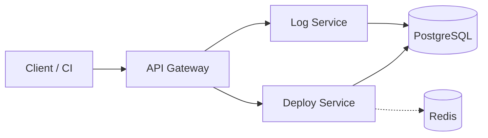

# DOP-001 — Deploy Status Checker

Source of truth: this local file (Notion page is stale — see `docs` repo history for the free-block-limit note that started this). Original Notion page (no longer updated): https://app.notion.com/p/3cfb4aef823981edb9b9e6e434231dbe

**2026-09-20 update:** §5, §9, §10, §16 revised and §17/§18 added to reflect the Kubernetes migration ("Day 15–17") that happened without a matching DOP update at the time — see §18 Version History.

**2026-10-12 audit (Day 21):** §7, §12, §13, §17 corrected; §11.1 (AC status) and §17.5 (Day 17 EKS deployment) added. Area content from §6–§9 and §17 moved into DOP-002/003/004/005 the same day; section numbers kept as pointers so existing references still resolve.

## 1. Problem Statement

When an incident occurs or a release needs to be checked, the on-call engineer has to open CI/CD, the log service, dashboards, and chat in several different places to find out:
- which version is currently running;
- which environment it was deployed to;
- whether the deploy succeeded, failed, or was rolled back;
- where the related logs are.

## 2. Project Goal

Deploy Status Checker is a central place for CI, engineers, and on-call engineers to track deploy status, release version, environment, and related logs.

## 3. Core Features

- CI reports a deploy event (service, environment, version) when a deployment starts.
- The system tracks that deploy through its release flow — started → success/failed → rolled back.
- Engineers and on-call engineers can view deploy history and the latest status per service/environment.
- CI attaches logs to a deploy; engineers retrieve them, in order, to investigate a failure.

## 4. Primary Users

- CI System
- Engineer
- On-call Engineer
- Platform/DevOps Engineer

## 5. System Architecture

| Service | Responsibility | Language / Framework / Version | Port |
|---|---|---|---|
| API Gateway | Entry point, authentication, routing | TypeScript / Node.js 24 / Express 5 | 3000 |
| Deploy Service | Deployment status | TypeScript / Node.js 24 / Express 5 / Prisma 6 | 3001 |
| Log Service | Deployment logs | TypeScript / Node.js 24 / Express 5 / Prisma 6 | 3002 |
| PostgreSQL | Persistent data | PostgreSQL 18 | 5432 |
| Redis | Cache | Redis 8 | 6379 |

> This is the locked-in stack for the whole project — every Dockerfile, package.json, docker-compose.yml, **and Helm values file** must pin exactly these versions. Never use the `latest` tag.
>
> **2026-09-20:** PostgreSQL/Redis versions updated from 16/7 to **18/8** to match reality — the Kubernetes migration (§17) installed both via Bitnami Helm charts without pinning `image.tag`, which silently resolved to `latest` and pulled 18.6/8.10.2. Ratifying what's actually running rather than requiring a disruptive downgrade. **Not yet fixed:** the Helm values files (`infra/k8s/my-postgres-values.yaml`, `my-redis-values.yaml`) still don't pin `image.tag` explicitly, so a future `helm upgrade` can silently drift again — tracked in TIE-40.

- Clients and CI only call the API Gateway.
- API Gateway calls Deploy Service and Log Service.
- Deploy Service and Log Service never call each other directly.

## 6. VM Deployment

Moved to [DOP-004](DOP-004.md) (Cloud Infrastructure) on 2026-10-12. Full original text: git history of this file before that date.

## 7. Docker Deployment

Moved to [DOP-002](DOP-002.md) (Containerization) on 2026-10-12.

## 8. Docker Compose and Container Networking

Moved to [DOP-002](DOP-002.md) (Containerization) on 2026-10-12.

## 9. Host Topology and High Availability

Moved to [DOP-003](DOP-003.md) (Orchestration) on 2026-10-12. Product-level requirement unchanged: AC-02 / AC-04 (§11), FR-5 (§15).

## 10. Database Reliability

- Deploy Service owns `deploy_db`; Log Service owns `log_db`.
- A single PostgreSQL container is not safe enough for production — a single point of failure that could lose both `deploy_db` and `log_db`.
- Team decision: use a **PostgreSQL primary/replica cluster** (one primary for writes, one or more replicas for reads and ready to be promoted if the primary fails) instead of a single container. Reason: avoids locking into one cloud provider's managed service, keeps failover under the team's control, and fits the current VM/Docker Compose deployment; when moving to AWS this can be swapped for managed PostgreSQL Multi-AZ without changing the application architecture.
- **Implemented 2026-09-20 (TIE-28), on Kubernetes:** one primary + one streaming read replica via the `bitnami/postgresql` Helm chart (`architecture: replication`) — not `postgresql-ha`/repmgr, so promotion is a scripted, operator-triggered `SELECT pg_promote();`, not unattended automatic failover. Rehearsed live: primary killed → replica promoted → both `deploy-service`/`log-service` resumed read/write with the pre-outage data intact and no manual restoration. Full procedure in `infra/memory/kubernetes-project.md` §6 and §17 below.
- Regular backups, restore testing, and forward-only migrations are required. **Implemented 2026-09-17 (TIE-29)** for the Docker Compose target (`infra/scripts/backup-db.sh`/`restore-db.sh`, `pg_dump -Fc`, 7-day retention) — **not yet ported to the Kubernetes target**; the Helm-managed primary's PVC has no backup mechanism of its own yet (candidate follow-up).
- Redis is a cache only; a Redis failure must not bring the system down. Unchanged on Kubernetes (`bitnami/redis`, `architecture: standalone`) — but now has `auth.password` set, which the original bare-Compose Redis didn't (see IRD-003 note pending).

## 11. Acceptance Criteria

*(Written in Docker Compose terms since that's how they were originally verified. AC-01/AC-03/AC-05 have since also been verified on the Kubernetes target — §17 — with `docker compose pull/up -d` read as `kubectl rollout`/Helm equivalents.)*

| ID | Given | When | Then |
|---|---|---|---|
| AC-01 | A new image version is pushed and tagged | it is deployed via `docker compose up -d <service>` | the service passes its health check within the configured retries and starts receiving traffic |
| AC-02 | A deployed service fails its health check | the failure persists past the retry threshold | the load balancer stops routing traffic to that instance |
| AC-03 | A production incident requires reverting a release | the team rolls back to the previous image tag and restarts the service | the service returns to a healthy state with no data loss |
| AC-04 | One of the two production application hosts goes down | the load balancer detects the failed health check | traffic keeps being served by the remaining host with no downtime for the client |
| AC-05 | The PostgreSQL primary fails | a replica is promoted | Deploy Service and Log Service resume read/write operations without manual data restoration |
| AC-06 | Redis becomes unavailable | Deploy Service reads deploy status | it falls back to PostgreSQL and keeps serving correct data |
| AC-07 | A CI run sends `POST /deploys` twice with the same `ci_run_id` | both requests are sent in sequence | only one record exists in `deploy_db` |
| AC-08 | A new production environment is being provisioned | the team reviews the deployment architecture | the database is configured as a primary/replica cluster, not a single PostgreSQL container |
| AC-09 | A backend service takes longer than the configured timeout to respond | the API Gateway is calling that service | the gateway returns 504 Gateway Timeout to the client within 1 second |
| AC-10 | The team reviews the log retention policy | the policy is documented and applied | logs are retained for at least 30 days and old logs are purged automatically (per IRD-002 §6) |

### 11.1 AC status (audited 2026-10-12)

Rule used: **DONE** only with a recorded verification (rehearsal, commit, or memory-file evidence). Implemented-but-never-verified = **ACTIVE**.

| AC | Status | Evidence / reason |
|---|---|---|
| AC-01 | DONE | Compose: `infra/scripts/deploy.sh` health-gate (TIE-22, `85349cc`). K8s: readinessProbe-gated rollout (DOP-003 AC-2) |
| AC-02 | DONE (re-scoped to K8s) | "Load balancer stops routing" is implemented as readinessProbe → Pod removed from Service endpoints; hit for real in the Day 16 incident (DOP-003 AC-2) |
| AC-03 | DONE | TIE-22 rollback rehearsal (Compose); `helm rollback` exercised Day 16 (`infra/memory/kubernetes-project.md`) |
| AC-04 | ACTIVE | Not met: every Deployment is `replicas: 1`, cluster was single-node. Re-scoped to K8s terms: ≥2 replicas on ≥2 nodes. TIE-25/26/27 open |
| AC-05 | DONE | TIE-28 failover rehearsal 2026-09-20: primary killed → `pg_promote()` → both services resumed read/write with pre-outage data (`infra` `5c10933`) |
| AC-06 | ACTIVE | Fallback implemented (`deploy-service` `543d22b`); no recorded test with Redis actually down |
| AC-07 | DONE | Verified 2026-10-12 on minikube through the gateway: 1st `POST /deploys` → 201, repeat with same `ci_run_id` → 200 + same `id`, DB count = 1, `UNIQUE INDEX deploys_ci_run_id_key` present. Code `deploy-service` `55deb5a`. Trace: `proops2026/memory/dop-ird-trace.md` |
| AC-08 | DONE | `bitnami/postgresql` `architecture: replication` (`infra/k8s/my-postgres-values.yaml`, TIE-28) |
| AC-09 | ACTIVE | Implemented (`api-gateway/src/index.ts` — 5 s default / 2 s `/overview` upstream timeout → 504); no recorded verification |
| AC-10 | ACTIVE | Daily 30-day purge implemented (`log-service` `42a9a22`, TIE-33); no recorded test purge against a live DB |

No AC is DROPPED. AC-02 and AC-04 keep their intent; only the mechanism changed (Kubernetes instead of two fixed hosts behind a load balancer).

## 12. Definition of Done

| # | Criterion |
|---|---|
| 1 | Each service builds a Docker image from its multi-stage Dockerfile without errors |
| 2 | `docker compose up -d` brings up all services on the pinned stack versions (Node.js 24, Express 5, Prisma 6, PostgreSQL 18, Redis 8 — per §5) with every health check passing |
| 3 | Services communicate only via service-name DNS inside the `backend` network; only API Gateway is reachable from `frontend` |
| 4 | The rollback procedure (previous tag + restart) has been exercised at least once and verified working |
| 5 | Database backup and restore have been tested at least once |
| 6 | Two-host + load balancer failover has been verified — killing one host does not interrupt client traffic |
| 7 | No secret or credential is hardcoded in any Dockerfile, compose file, or source file |
| 8 | A duplicate `POST /deploys` with the same `ci_run_id` does not create a second record (AC-07) |
| 9 | The API Gateway returns 504 within 1 second when an upstream service times out (AC-09) |
| 10 | A documented log retention policy is in force and has been verified by a test purge (AC-10) |

## 13. Non-Goals

- Executing deployments automatically — CI remains the trigger, this system only records and reports.
- Replacing the CI/CD tool itself.
- Hosting source code.
- Being a full monitoring/tracing/alerting platform.
- Multi-region active-active deployment.
- Auto-scaling (HPA/KEDA).
- Service mesh (Istio/Linkerd).
- Multi-cloud / cross-cloud failover.
- Canary or blue/green deployment strategies (we use rolling + manual rollback).
- External notifications or chat integrations (Slack/Discord webhooks, message queues) — none exist today; adding one requires a DOP update first.

## 14. Success Metrics

| Metric | Target |
|---|---|
| Health check response time | < 500ms |
| Rollback time (previous tag → healthy) | < 2 minutes |
| Host failover time (load balancer detects + reroutes) | < 30 seconds |
| Database failover time (replica promotion) | < 5 minutes |
| Backup restore time (verified in a test run) | < 30 minutes |
| API Gateway p99 latency (all routes) | < 200ms |
| Log Service write throughput | > 100 logs/sec sustained |
| Cache miss / fallback to PostgreSQL latency (when Redis is down) | < 200ms p99 |

## 15. Functional Requirements

| ID | Requirement | IRD Reference |
|---|---|---|
| FR-1 | Each service is deployed as an independently versioned Docker container | IRD-003 §6, IRD-005 |
| FR-2 | Deploy Service records and exposes deploy status per service/environment | IRD-001 |
| FR-3 | Log Service stores and serves deployment logs, paginated | IRD-002 |
| FR-4 | API Gateway is the only public entry point, routes to backend services, and loads authentication configuration from environment variables | IRD-003 §3–§4, §6 |
| FR-5 | Production runs two application hosts behind a load balancer for HA | IRD-006 (K8s: replicas + readiness; DOP-003 AC-9) |
| FR-6 | PostgreSQL runs as a primary/replica cluster, not a single container | DOP-001 §10 |
| FR-7 | `POST /deploys` is idempotent on `ci_run_id` | IRD-001 §1, AC-07 |
| FR-8 | API Gateway enforces a per-route upstream timeout and returns 504 on timeout | IRD-003 §3, AC-09 |
| FR-9 | Log retention is bounded by a documented policy and enforced automatically | IRD-002 §6, AC-10 |

## 16. Non-Functional Requirements

| ID | Requirement |
|---|---|
| NFR-1 | No secret or credential is hardcoded in any Dockerfile, compose file, or source file |
| NFR-2 | All application containers are stateless and can be recreated without data loss |
| NFR-3 | All images are pinned to explicit versions; the `latest` tag is never used. **Extends to Helm chart `image.tag` values (§17), not just the 3 app Dockerfiles** — currently **not met** for `my-postgres`/`my-redis` (both resolve to `latest`, see §5 2026-09-20 note), tracked in TIE-40. |
| NFR-4 | Every service exposes a `/health` endpoint used by Compose health checks |
| NFR-5 | A Redis failure degrades gracefully (fallback to PostgreSQL) and never causes an outage |

## 17. Kubernetes Deployment

Moved to [DOP-003](DOP-003.md) (Orchestration) on 2026-10-12 — component mapping, apply order, probe policy, known gaps. The Day 17 EKS facts (former §17.5) are split between [DOP-003](DOP-003.md) and [DOP-004](DOP-004.md). References elsewhere in this file to "§17" now mean DOP-003.

### 17.1 Area DOPs

| DOP | Area | Status |
|---|---|---|
| [DOP-002](DOP-002.md) | Containerization | ACTIVE |
| [DOP-003](DOP-003.md) | Orchestration | ACTIVE |
| [DOP-004](DOP-004.md) | Cloud Infrastructure | PARTIAL |
| [DOP-005](DOP-005.md) | IaC + Automation | DEFERRED → Day 26 |

## 18. Version History

| Date | Change |
|---|---|
| 2026-09-09 (approx.) | Initial DOP-001, Docker-Compose-only |
| 2026-09-20 | §5 (Postgres 16→18, Redis 7→8, ratifying the unpinned-Helm-chart drift), §9 (Kubernetes topology, HA not yet met), §10 (TIE-28 primary/replica implementation), §16 NFR-3 (extended to Helm tags), §17/§18 added — reconciling the DOP with the "Day 15–17" Kubernetes migration that happened without a matching DOP update at the time |
| 2026-10-12 | Day 21 audit: §11.1 AC status table (6 DONE / 4 ACTIVE / 0 DROPPED after AC-07 trace), §12 DoD versions aligned with §5, §13 non-goal for external integrations, §17.5 Day 17 EKS facts + conflicts, dangling refs (`IRD-007-to-be`, `DOP-002/IRD-005`, `IRD-008?`) resolved. Same day: §6–§9 and §17 moved into DOP-002/003/004 (pointers left in place), §17.1 area-DOP index added |

---

Last audited: 2026-10-12
Audited by: Tien Nguyen (solo — no partner assigned)
Next audit: end of Week 6 (Day 30)
