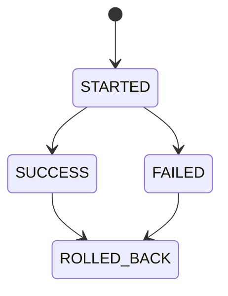

# IRD-001 — Deploy Service Requirements

Implements: [DOP-001](DOP-001.md) (FR-2, FR-7; AC-06, AC-07) · Runs per [DOP-003](DOP-003.md) / [IRD-006](IRD-006.md)  
Last audited: 2026-10-12 (Day 21 — link header added; content refresh tracked in `memory/dop-ird-system.md`)

Source of truth: this local file (moved off Notion after it hit its free-block limit; see `docs` repo commit "Document pending IRD-001/IRD-003 updates blocked on Notion free-block limit"). Original Notion page (stale, no longer updated): https://app.notion.com/p/3cfb4aef8239813e8537da5ffed83e37

## 1. Decision

1. Deploy Service is the single source of truth for deploy status; no other service writes to `deploy_db`.
2. Deploy status follows a fixed state machine (STARTED → SUCCESS/FAILED → ROLLED_BACK), enforced server-side.
3. Create requests are idempotent on `ci_run_id` — a retry never creates a duplicate record. Satisfies DOP-001 AC-07.
4. Status reads prefer Redis and fall back to PostgreSQL when Redis is unavailable.
5. Writes (POST/PATCH /deploys) always go directly to PostgreSQL — Redis is cache only, never the source of truth for writes.
6. `GET /overview` reads a single Redis cache key (`deploy-service:overview:v2`) with a 30-second TTL; any Redis failure or command timeout (500 ms) falls back to PostgreSQL immediately, with no retry. Every successful create/update deletes the key. *(added per TIE-32 / TIE-11; key `v2` + invalidate-on-write per DSC-93, 2026-11-13)*
7. `ci_run_id` uniqueness (DOP-001 AC-07) is enforced by a database-level UNIQUE constraint on `deploy_db`, not an application-only check — this is what makes idempotency safe under concurrent CI retries. *(added per TIE-32 / TIE-12)*
8. Schema changes ship as real, committed migrations under `deploy-service/prisma/migrations/` — never `prisma db push` outside local dev. The Dockerfile's `builder` stage doubles as a `migrator` target (`CMD npx prisma migrate deploy`); the runtime image never gets the `prisma` CLI. On Kubernetes, a one-shot `Job` (`deploy-service/k8s/migrate-job.yaml`) runs the `migrator` image once, applied before rolling the Deployment — not a container startup step, so it never runs once per replica. *(added per TIE-39 / TIE-36)*

9. Status transitions are a single conditional `UPDATE … WHERE id = $1 AND status = ANY(<valid source states>) RETURNING *`. The database, not application code, decides whether a move is valid, so concurrent CI calls can never both win. 0 rows → 404 (no such deploy) or 409 (invalid transition). *(added per DSC-93, 2026-11-13)*
10. The public API is snake_case. Handlers return DTOs (`toDeployDto`), never Prisma objects. Every error uses one envelope: `{ "error": { "code": "UPPER_SNAKE", "message": "...", "details"?: [...] } }`. *(added per DSC-91, 2026-11-13 — closes trace gap G5)*

## 2. Purpose

Deploy Service is the source of truth for deploy status and release history.

## 3. Actors

- CI System
- Engineer
- On-call Engineer
- API Gateway

## 4. Scope

**Covers:** deploy status API, release-flow state machine, `deploy_db` ownership, Deploy Service's communication boundary.
**Does not cover:** API Gateway auth/routing (IRD-003), log storage (IRD-002).

## 5. Service Responsibility

- Owns and updates deploy status according to the release flow.
- Is the only place that answers "which version of service X is running, in which environment, in what status".
- Owns `deploy_db`; no other service reads or writes it directly.

## 6. Release Flow



- A deploy only moves to the next state if it is a valid transition per the diagram above.
- A duplicate create request (CI retry) never creates a new record. Satisfies DOP-001 AC-07.
- Reading the latest status prefers Redis; if Redis fails, it falls back to PostgreSQL.

### 6.1 Overview Cache Policy

*(added per TIE-32, source: TIE-11 implementation; revised per DSC-93, 2026-11-13)*

| Setting | Value |
|---|---|
| Cache key | `deploy-service:overview:v2` (`v1` held the old camelCase array; bumping the key means old values are never served) |
| TTL | 30 seconds |
| On Redis failure/timeout | Fall back to PostgreSQL immediately, no retry (500 ms connect/command timeout) |
| Invalidation | Key deleted on every successful `POST /deploys` (new record) and `PATCH /deploys/:id`. If the delete is lost (Redis down during the write, then restored from its RDB snapshot), the 30 s TTL bounds the staleness — observed 2026-11-13, accepted. *(closes trace gap G3)* |
| Source query on miss | `SELECT DISTINCT ON (service, environment) … ORDER BY service, environment, created_at DESC, id DESC`, backed by index `(service, environment, created_at DESC)` |

## 7. API

*(full contract added per DSC-91..93, 2026-11-13 — closes trace gaps G2, G5, G9)*

| Method | Path | Purpose | Auth (at the gateway) | Success |
|---|---|---|---|---|
| POST | `/deploys` | CI creates a deploy (idempotent on `ci_run_id`) | API key | 201 new · 200 existing |
| PATCH | `/deploys/:id` | Update status (only valid transitions) | API key | 200 |
| GET | `/deploys` | Deploy history, filters + cursor pagination | JWT | 200 |
| GET | `/deploys/:id` | One deploy | JWT | 200 |
| GET | `/overview` | Latest deploy per service/environment (Redis, falls back to PG) | JWT | 200 |
| GET | `/health` | Health check (pings PostgreSQL) | None | 200 / 503 |

**Deploy object** (every response that returns a deploy):
```json
{
  "id": "uuid", "service": "api-gateway", "environment": "prod", "version": "1.8.0",
  "status": "FAILED", "ci_run_id": "gha-123", "reason": "Readiness probe failed after 3 retries",
  "commit_sha": "3770d7d", "ci_run_url": "https://github.com/…/actions/runs/1", "triggered_by": "tert62",
  "created_at": "2026-11-13T10:20:59.553Z", "updated_at": "2026-11-13T10:21:40.120Z"
}
```

**POST `/deploys` body:**

| Field | Rule |
|---|---|
| `service` | required, 1–100 chars, `[A-Za-z0-9._-]` |
| `environment` | required, `dev` / `staging` / `prod` |
| `version` | required, 1–100 chars |
| `ci_run_id` | required, 1–200 chars, unique (AC-07) |
| `commit_sha` | optional, 7–40 hex chars, stored lower-case |
| `ci_run_url` | optional, http(s) URL ≤ 2048 chars |
| `triggered_by` | optional, 1–100 chars |

A repeat with an existing `ci_run_id` returns **200** and the stored record, unchanged (payload differences are ignored).

**PATCH `/deploys/:id` body:** `{ "status": "FAILED", "reason": "Health check failed after 3 retries" }`.
`reason` (1–2000 chars) is required for `FAILED` and `ROLLED_BACK`. Invalid transition → **409** `{ "error": { "code": "INVALID_TRANSITION", "message": "…", "current_status": "SUCCESS" } }`.

**GET `/deploys` query parameters:**
- `service`, `environment` (dev/staging/prod), `status` (STARTED/SUCCESS/FAILED/ROLLED_BACK) — exact-match filters
- `from` (inclusive), `to` (exclusive) — ISO 8601 timestamps on `created_at`; `from` must be before `to`
- `limit` — integer 1–100, default 20
- `cursor` — opaque value from a previous `next_cursor` (keyset on `created_at DESC, id DESC`)

The earlier `page` parameter is **removed**: offset paging skips or repeats rows when new deploys arrive between page loads.

**GET `/deploys` response:** `{ "items": [ /* deploy objects, newest first */ ], "next_cursor": "…" | null, "total_count": 137 }` — `total_count` counts all rows matching the filters (a `COUNT(*)`; watch-point if the table grows large).

**GET `/overview` response:** `{ "items": [ /* latest deploy per service/environment */ ] }` (was a bare array before 2026-11-13).

**Errors:**

| Status | `error.code` | When |
|---|---|---|
| 400 | `VALIDATION_ERROR` (+ `details[]`) | body/query/path fails the rules above (incl. non-UUID `:id`) |
| 400 | `INVALID_JSON` | malformed JSON body |
| 404 | `NOT_FOUND` | unknown deploy or unknown route |
| 409 | `INVALID_TRANSITION` | status move not allowed by §6 |
| 413 | `PAYLOAD_TOO_LARGE` | body > 100 kB |
| 500 | `INTERNAL` | anything else; details are logged server-side with the request id, never returned |

## 8. Data Model

| Field | Type |
|---|---|
| `id` | UUID (PK) |
| `service` | string |
| `environment` | enum (dev/staging/prod) |
| `version` | string |
| `status` | enum (STARTED/SUCCESS/FAILED/ROLLED_BACK) |
| `ci_run_id` | string (unique) |
| `reason` | text (nullable) — failure / rollback reason for on-call visibility |
| `commit_sha` | text (nullable) — *(added per DSC-93)* |
| `ci_run_url` | text (nullable) — *(added per DSC-93)* |
| `triggered_by` | text (nullable) — *(added per DSC-93)* |
| `created_at` / `updated_at` | timestamp |

`ci_run_id` carries a database-level `UNIQUE` constraint — this is the actual enforcement mechanism for AC-07 idempotency (see Decision #7), not just an application-level check. *(added per TIE-32 / TIE-12)*

Indexes *(added per DSC-92/93, migration `20261113151111_add_deploy_metadata_and_indexes`)*: `(created_at DESC, id DESC)` for history pagination; `(service, environment, created_at DESC)` for `/overview`.

## 9. Service Communication Boundary

- Called by: API Gateway.
- Allowed to call: `deploy_db` (PostgreSQL), Redis (read-only for `/overview`).
- Must not call: Log Service, under any circumstance.

## 10. Failure Behavior

If Deploy Service fails, deploy status can't be read or updated; Log Service keeps operating independently.

## 11. User Stories

Acceptance Criteria (AC-xx) live only in DOP-001 §11. The Related DOP AC column below traces each story back to the AC it helps satisfy, where one applies.

| ID | Priority | Given | When | Then | Related DOP AC |
|---|---|---|---|---|---|
| US-DS-01 | High | CI has just started deploying a service | CI notifies Deploy Service | the system records the deploy in the started state | AC-01 |
| US-DS-02 | High | A deploy record already exists for the same CI run | CI sends the same information again | the system does not create a new record | AC-07 |
| US-DS-03 | Medium | An Engineer needs to see recent deploys | the Engineer looks up deploy history (with filters) | the system returns the filtered list of deploys, newest first | — |
| US-DS-04 | High | A production incident is in progress | the on-call engineer checks the latest deploy status | the system reports the service, environment, version, status, and failure reason if any | — |

## 12. Definition of Done

| # | Criterion |
|---|---|
| 1 | POST `/deploys` creates a record; a duplicate `ci_run_id` never creates a second record (DOP-001 AC-07) |
| 2 | PATCH `/deploys/:id` only accepts transitions that are valid per the release flow state diagram; `reason` is required for FAILED and ROLLED_BACK |
| 3 | GET `/overview` reads from Redis and falls back to PostgreSQL when Redis is down |
| 4 | GET `/deploys` supports all query parameters and returns paginated results with `next_cursor` and `total_count` |
| 5 | The Deploy Service container passes its health check in the Compose stack |
| 6 | All four user stories above are verified with tests |

## 13. Impact

Any service that wants deploy status visibility must go through API Gateway → Deploy Service; it must never read `deploy_db` directly or query another service's database.
